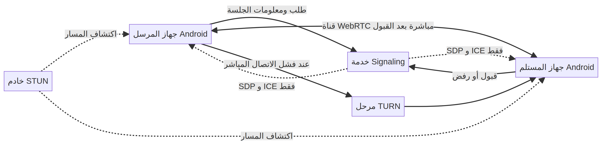

# AFNOVA

**أرسلها بسرعة. ببساطة.** مشروع Flutter يهدف إلى مشاركة الملفات والمجلدات بين أجهزة Android عبر الإنترنت، مع موافقة المستلم قبل النقل.

[](https://github.com/Afnnabdo101/afnova/actions/workflows/flutter.yml)  


> **الحالة الحالية: نموذج واجهة أولي.** اختيار الملفات من الجهاز، عرض الواجهة العربية، والدليل المصور تعمل محليًا. الاتصال بين جهازين وقبول الطلب والنقل الفعلي لم تُنفّذ بعد. الرسومات في هذا المستودع مفاهيمية وليست لقطات من تطبيق مكتمل.

## فكرة المشروع

يهدف AFNOVA إلى تسهيل نقل ملف أو مجلد من جهاز Android إلى جهاز آخر عبر الإنترنت حتى عندما يكونان على شبكتين مختلفتين. المسار المقترح بسيط: يختار المرسل المحتوى، يرى المستلم تفاصيل الطلب ويقبله أو يرفضه، ثم يبدأ النقل بعد القبول. الهدف هو الاتصال المباشر متى سمحت الشبكة، مع خدمة إشارات لتنسيق الاتصال ومرحل TURN عند الحاجة.


من أهداف التصميم عدم تمرير محتوى الملفات عبر خادم تخزين في المسار الطبيعي. هذا هدف قيد التصميم وليس ضمانًا أو ميزة منفذة في النسخة الحالية.

## ما يعمل وما يزال مخططًا

في النموذج الحالي تعمل واجهة Flutter العربية RTL، واختيار عدة ملفات محليًا وعرض أسمائها وأحجامها، ومعرض الكتيب المصور والتنقل بين صفحاته. تتضمن الواجهة أيضًا حركة دخول خفيفة للرسمة الرئيسية وانتقالات سلسة في الدليل. هذه حركات بصرية فقط؛ لا تحاكي نقلًا حقيقيًا.

ما يزال الاتصال الفعلي وWebRTC/Signaling وSTUN/TURN وطلب القبول/الرفض ونقل المحتوى والتشفير والاستئناف والإرسال الجماعي ضمن مراحل التطوير. راجع [نظرة المشروع](docs/PROJECT-OVERVIEW.md) و[خارطة التطوير](docs/DEVELOPMENT-ROADMAP.md) و[قائمة المهام](docs/TASK-BACKLOG.md).


هذه الصورة تشرح هدفًا بصريًا ولا تثبت تنفيذ تشفير أو مراجعة أمنية. للاطلاع على القيود ومخاطر التصميم، راجع [الأمان والخصوصية](docs/SECURITY-AND-PRIVACY.md).

## اتجاه التقنية

العميل مبني بـ Flutter وDart ويستهدف Android أولًا. الاتجاه المقترح للنقل هو WebRTC DataChannel مع تبادل معلومات الاتصال عبر Signaling واستخدام STUN/TURN بحسب ظروف الشبكة. لا توجد خدمة Signaling أو TURN مهيأة في هذا النموذج.

المخطط التالي يصف التصميم المقترح فقط؛ مصدره القابل للتعديل هو [`docs/diagrams/p2p-transfer.mmd`](docs/diagrams/p2p-transfer.mmd).



اقرأ [معمارية النظام](docs/SYSTEM-ARCHITECTURE.md) و[قرارات المشروع](docs/DECISIONS.md) و[دليل التصميم](docs/DESIGN-GUIDE.md).

## التشغيل محليًا

المتطلبات: Flutter SDK مستقر يدعم Dart 3.3 أو أحدث، وAndroid SDK أو Android Studio، وجهاز Android أو محاكي.

```bash
git clone https://github.com/Afnnabdo101/afnova.git
cd afnova
flutter pub get
flutter run
```

للتحقق من التنسيق والتحليل والاختبارات:

```bash
dart format --output=none --set-exit-if-changed .
flutter analyze
flutter test
```

تعمل هذه الفحوص على الشيفرة والواجهة؛ لا تختبر اتصال جهازين أو نقل ملفات عبر الإنترنت بعد.

## خريطة المستودع

```text
android/                     إعداد منصة Android
assets/
  guide/                     صفحات كتيب AFNOVA المصوّر
  illustrations/              رسومات الفكرة والميزات والخصوصية
  README.md                  شرح تنظيم الأصول
  media-sources.md            مصدر كل صورة وحالتها
lib/
  screens/                    الشاشة الرئيسية والدليل
  widgets/                    بطاقات الإجراءات والميزات ومعرض الرسومات
  models/                     بيانات عرض خارطة الطريق
docs/
  diagrams/                   مصادر مخططات Mermaid وصورها
  PROJECT-OVERVIEW.md         الفكرة والنطاق الحالي
  SYSTEM-ARCHITECTURE.md      تصميم الاتصال المستهدف
  DEVELOPMENT-ROADMAP.md      المراحل ومعايير انتقالها
  TASK-BACKLOG.md             قائمة المزايا والاختبارات
  TESTING-STRATEGY.md         الفحوص الحالية والمطلوبة
  SECURITY-AND-PRIVACY.md     مبادئ الأمان والخصوصية
  DESIGN-GUIDE.md             الهوية المرئية والحركة
  DECISIONS.md                القرارات التقنية وحدودها
test/                         اختبارات Flutter
.github/                      فحوص CI وقوالب Issues وPull Requests
```

## الصور والحركة

تُحفظ الرسوم المفاهيمية منفصلة عن صفحات الدليل، وتُسجل مصادرها في [`assets/media-sources.md`](assets/media-sources.md). صور الكتيب محفوظة كما هي ضمن [`assets/guide/`](assets/guide/). في واجهة التطبيق، تظهر الرسمة الرئيسية بدخول متدرج، وينتقل الدليل بين الصفحات بسلاسة؛ لا توجد حركات تمثل حالة نقل حقيقية.

## المساهمة والترخيص

راجع [CONTRIBUTING.md](CONTRIBUTING.md) قبل فتح طلب دمج. لا يحتوي المستودع حاليًا على ترخيص مفتوح المصدر محدد؛ لا تفترض أن وجود الملفات في مستودع عام يمنح حق إعادة استخدامها خارج المشروع.
