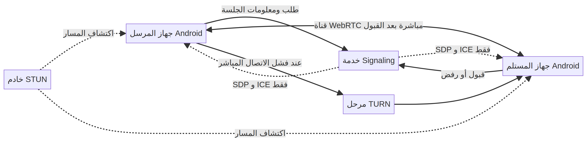
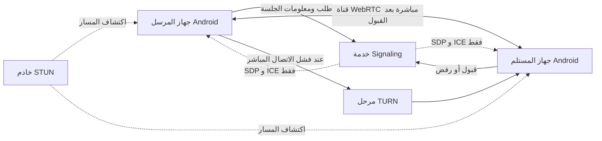

# معمارية AFNOVA المستهدفة

> **التنفيذ الحالي:** لا توجد بعد خدمة إشارات أو جلسة WebRTC. يصف هذا الملف التصميم المقترح، لا خصائص عاملة.

## المكونات

- **تطبيق Android المرسل:** يختار الملفات، ويبدأ طلب النقل، ويدير حالة الإرسال.
- **تطبيق Android المستقبِل:** يعرض تفاصيل الطلب، وينتظر قرار قبول أو رفض صريح.
- **خدمة Signaling:** تمرر بيانات إنشاء الاتصال بين الجهازين (SDP وICE candidates). لا يفترض أن تمرر محتوى الملف.
- **STUN:** يساعد كل جهاز على اكتشاف عنوان اتصال يمكن تجربته لإنشاء مسار مباشر.
- **TURN:** مرحّل احتياطي ينقل بيانات الاتصال عندما تمنع الشبكة إنشاء مسار مباشر. لا يعد تخزينًا دائمًا للملف.
- **WebRTC DataChannel:** قناة البيانات المخطط استخدامها لإرسال محتوى الملف بعد موافقة المستلم ونجاح الاتصال.

## تسلسل الاتصال

1. ينشئ المرسل طلبًا ويشارك رمز جلسة قصير العمر عبر خدمة الإشارات.
2. يراجع المستلم الطلب ويقبل أو يرفض. لا يرسل التطبيق المحتوى قبل القبول.
3. بعد القبول، يتبادل الطرفان معلومات وصف الجلسة ومرشحي ICE عبر خدمة الإشارات.
4. تحاول الأجهزة إنشاء اتصال مباشر باستخدام مسارات ICE وSTUN.
5. إذا تعذر المسار المباشر، يُختبر TURN بوصفه مرحّلًا. يجب توضيح استخدام المرحّل وسياسة الاحتفاظ ببياناته.
6. عند نجاح قناة البيانات، يبدأ نقل المحتوى وتحديث حالة كل طرف.

## مخطط الاتصال

المصدر القابل للتعديل: [`diagrams/p2p-transfer.mmd`](diagrams/p2p-transfer.mmd).

## ضوابط التصميم

- لا يبدأ إرسال المحتوى قبل قرار المستلم.
- تمر بيانات التفاوض عبر Signaling؛ لا تُرسل بايتات الملفات إلى الخدمة في المسار الطبيعي.
- يُقيّم مسار TURN كمسار مرحّل، ولا يُوصف بأنه اتصال مباشر.
- تُعالج أسماء الملفات وأحجامها كبيانات قد تكشف معلومات شخصية.
- لا تُعلن ميزات التشفير أو الخصوصية كمنجزة قبل التنفيذ والاختبار والمراجعة.
- إذا احتاجت ميزة الإرسال المؤجل تخزينًا سحابيًا، تتطلب قرارًا منفصلًا وموافقة واضحة.

## مراحل التحقق

قبل الاعتماد على هذا التصميم، يجب إثبات الاتصال بين جهازين Android على شبكتين مختلفتين، واختبار STUN وTURN، وقياس حجم الملفات وسلوك الانقطاع، والتحقق من الرفض والإلغاء، ومراجعة إعدادات التشفير وتخزين بيانات الجلسة.
